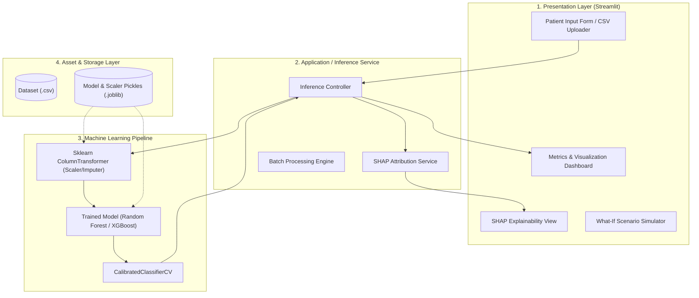
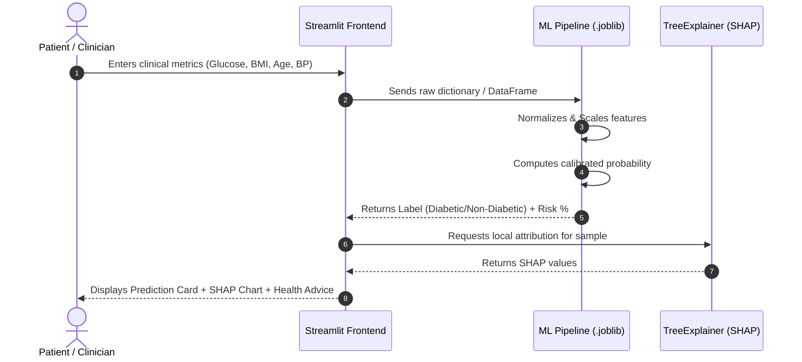

# Software Requirements and Design Document (SRDD)
## AI-Based Diabetes Prediction System

---

### Document Control
- **Project Title:** AI-Based Diabetes Prediction System
- **Document Type:** Software Requirements & Design Document (SRDD)
- **Version:** 1.0
- **Status:** Approved / Baseline for Development
- **Target Platform:** Python 3.10+, Streamlit, Scikit-Learn

---

## 1. Introduction

### 1.1 Purpose
The purpose of this document is to define the functional, non-functional, and architectural requirements for the **AI-Based Diabetes Prediction System**. It bridges clinical risk assessment and machine learning engineering to deliver an interpretable, reliable, and user-friendly web application for healthcare workers and individuals.

### 1.2 Scope
The system ingests tabular biometric data (such as BMI, glucose level, age, blood pressure, and lifestyle indicators) to predict the likelihood of diabetes. Beyond binary classification (`0` for Non-Diabetic, `1` for Diabetic), the application provides:
- Quantitative probability scores (calibrated risk percentage).
- Feature-level explainability powered by SHAP (SHapley Additive exPlanations).
- An interactive "What-If" lifestyle counterfactual simulator.
- Batch assessment capabilities via CSV upload.

### 1.3 Intended Audience
- Project Evaluators / Faculty Mentors
- Machine Learning Engineers & Software Developers
- Quality Assurance / Testers

---

## 2. Overall System Description

### 2.1 Product Perspective
The system operates as an end-to-end standalone predictive application. It consumes standardized health surveys/records (e.g., CDC BRFSS dataset or Pima Indian Diabetes dataset), trains an ensemble classification pipeline with data-leakage prevention, and exposes real-time inference through a Streamlit frontend.


### 2.2 User Classes & Personas
1. **End User / Patient:** Non-technical individual seeking a preliminary health check and lifestyle advice.
2. **Healthcare Professional / Clinician:** Evaluates risk metrics, views feature impact (SHAP), and conducts batch screenings.
3. **System Administrator / Evaluator:** Inspects model performance, confusion matrices, and ROC-AUC curves.

### 2.3 Operating Constraints
- **Data Privacy:** Patient data entered in real-time is evaluated in-session and not persisted to disk without consent.
- **Compute Resource:** Must train and execute on commodity hardware (standard CPU / 8GB RAM).

---

## 3. System Requirements Specification (SRS)

### 3.1 Functional Requirements (FR)

| Req ID | Module | Description | Priority |
| :--- | :--- | :--- | :--- |
| **FR-01** | Data Ingestion | Accept structured inputs for biometric features (Age, BMI, Blood Pressure, Glucose, Cholesterol, Physical Activity). | High |
| **FR-02** | Data Preprocessing | Impute missing values, apply numerical standardization (`StandardScaler`), and encode categorical flags. | High |
| **FR-03** | Imbalance Mitigation | Address class imbalance using SMOTE or cost-sensitive class weights (`class_weight='balanced'`). | High |
| **FR-04** | Binary Classification | Classify patients as Diabetic (`1`) or Non-Diabetic (`0`) with a calibrated risk score (0–100%). | High |
| **FR-05** | Model Comparison | Compare performance between baseline (Logistic Regression) and ensemble models (Random Forest, XGBoost). | Medium |
| **FR-06** | Explainable AI (XAI) | Compute and render a SHAP waterfall plot showing positive and negative contributors to the patient's risk. | High |
| **FR-07** | "What-If" Simulator | Allow users to alter modifiable risk factors (BMI, exercise) to observe dynamic changes in risk score. | Medium |
| **FR-08** | Batch Inference | Support CSV upload with multiple patient records; return downloadable predictions. | Medium |
| **FR-09** | Report Generation | Export a summary PDF/Text card with prediction results and health tips. | Low |

### 3.2 Non-Functional Requirements (NFR)

* **Performance & Latency (NFR-01):** Single-patient inference and SHAP calculation must execute within $\le 1.5\text{ seconds}$.
* **Accuracy & Safety (NFR-02):** The model must prioritize **Recall** ($\ge 80\%$) on the positive (diabetic) class to minimize false negatives.
* **Usability (NFR-03):** Clean, accessible interface with intuitive input widgets (sliders, numeric inputs, categorical dropdowns).
* **Maintainability (NFR-04):** Codebase structured into modular packages (data, models, utils, app).

---

## 4. System Design Document (SDD)

### 4.1 System Architecture

The application adopts a **4-Layer Decoupled Architecture**:



---

### 4.2 Data Flow Diagram (DFD Level 1)



---

### 4.3 Feature Schema Specification

| Feature Name | Clinical Concept | Data Type | Expected Range | Normal Baseline |
| :--- | :--- | :--- | :--- | :--- |
| `Age` | Patient age in years | Integer | $18 - 100$ | $N/A$ |
| `BMI` | Body Mass Index ($\text{kg/m}^2$) | Float | $12.0 - 60.0$ | $18.5 - 24.9$ |
| `Glucose` | Fasting blood glucose level ($\text{mg/dL}$) | Float | $50.0 - 300.0$ | $70.0 - 99.0$ |
| `BloodPressure` | Diastolic blood pressure ($\text{mmHg}$) | Integer | $40 - 140$ | $\le 80$ |
| `Cholesterol` | Total cholesterol status or continuous | Categorical / Float | $0/1$ or $100 - 400$ | $< 200$ |
| `PhysActivity` | Physical activity in past 30 days | Binary | $0$ (No), $1$ (Yes) | $1$ |
| `GenHlth` | Self-reported general health scale | Ordinal | $1$ (Excellent) - $5$ (Poor) | $1 - 2$ |

---

### 4.4 Model Development & Evaluation Plan

#### Model Candidates
1. **Logistic Regression:** Serves as the linear, interpretable baseline.
2. **Random Forest Classifier:** Reduces variance, captures nonlinear feature interactions.
3. **XGBoost Classifier:** Gradient-boosted decision trees optimized for maximum tabular performance.

#### Validation & Training Strategy
- **Stratified K-Fold Cross Validation:** $K=5$ folds to prevent sampling bias on imbalanced classes.
- **Pipeline Encapsulation:** All scalers and encoders must be fitted solely on training splits to prevent data leakage.
- **Metrics Tracked:**
  $$\text{Recall} = \frac{TP}{TP + FN}, \quad \text{Precision} = \frac{TP}{TP + FP}, \quad F_1 = 2 \times \frac{\text{Precision} \cdot \text{Recall}}{\text{Precision} + \text{Recall}}, \quad \text{ROC-AUC}$$

---

### 4.5 User Interface (UI) Wireframe Specification

The Streamlit app is structured into a 3-tab layout:

1. **Tab 1: Single Patient Assessment (Primary View)**
   * **Left Panel (Sidebar):** Input widgets with sensible defaults and medical guideline hints.
   * **Main Center Panel:**
     * Prominent Risk Gauge (Green = Low Risk $<30\%$, Yellow = Moderate Risk $30-60\%$, Red = High Risk $>60\%$).
     * SHAP Waterfall plot displaying top 5 driving risk factors.
   * **Lower Section:** Dynamic "What-If" counterfactual sliders.

2. **Tab 2: Batch Screening (Clinical View)**
   * Drag-and-drop CSV upload widget.
   * Data validation check (verifying required columns).
   * Summary table with filterable risk categories and CSV download button.

3. **Tab 3: Model Performance & Insights (Transparency View)**
   * Confusion matrix and ROC-AUC curve.
   * Global feature importance chart.
   * Project documentation and clinical disclaimers.

---

## 5. Testing & Quality Assurance Plan

### 5.1 Unit & Integrity Tests
- **Input Validation:** Test boundary values (e.g., negative BMI, glucose $> 500$) to confirm graceful error handling.
- **Pipeline Reproducibility:** Verify that the saved `.joblib` pipeline produces identical outputs given a constant test vector.

### 5.2 Clinical Safety Verification
- **False Negative Audit:** Evaluate model behavior on edge-case high-risk profiles (e.g., high glucose + high BMI + advanced age) to ensure risk is never misclassified as low.

---

## 6. Project Deliverables & Repository Structure

```text
diabetes-prediction-system/
├── data/
│   ├── raw/                      # Original CSV dataset
│   └── processed/                # Cleaned/engineered data
├── models/
│   ├── best_model.joblib         # Serialized ML pipeline
│   └── scaler.joblib             # Fitted preprocessors
├── notebooks/
│   ├── 01_eda.ipynb              # Exploratory data analysis
│   └── 02_model_training.ipynb   # Model benchmarking & tuning
├── src/
│   ├── __init__.py
│   ├── data_loader.py            # Data loading & splitting
│   ├── preprocessing.py          # Custom transformation logic
│   └── train.py                  # Training pipeline script
├── app.py                        # Streamlit web application
├── requirements.txt              # Pinned Python dependencies
├── README.md                     # Setup instructions & documentation
└── srdd.md                       # This SRDD document
```
